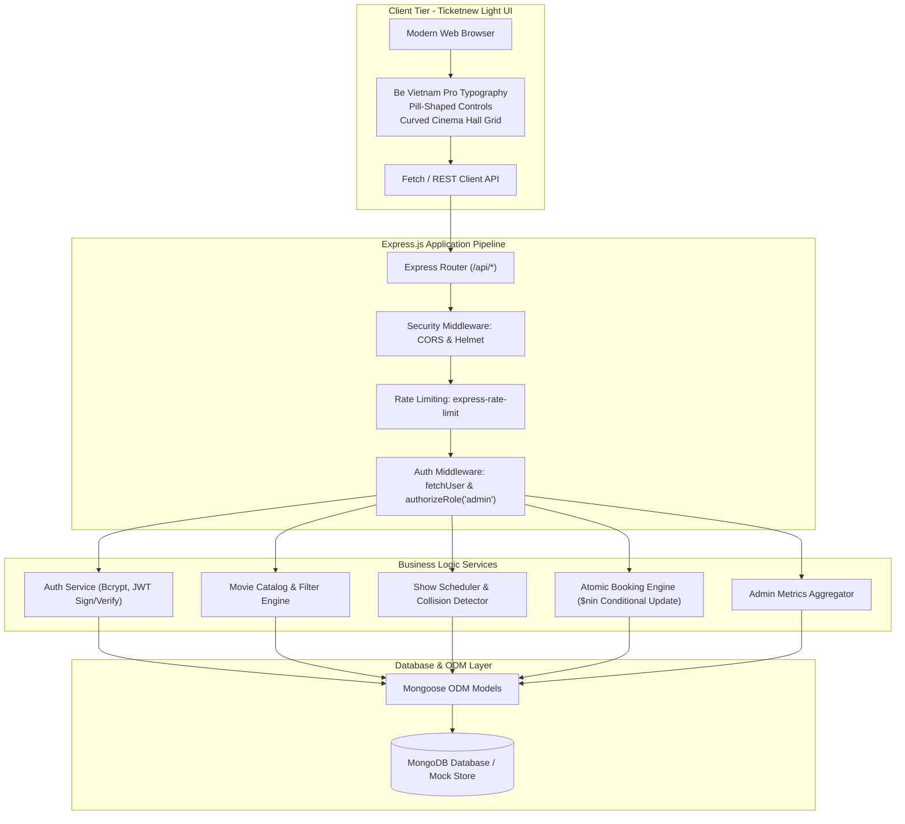
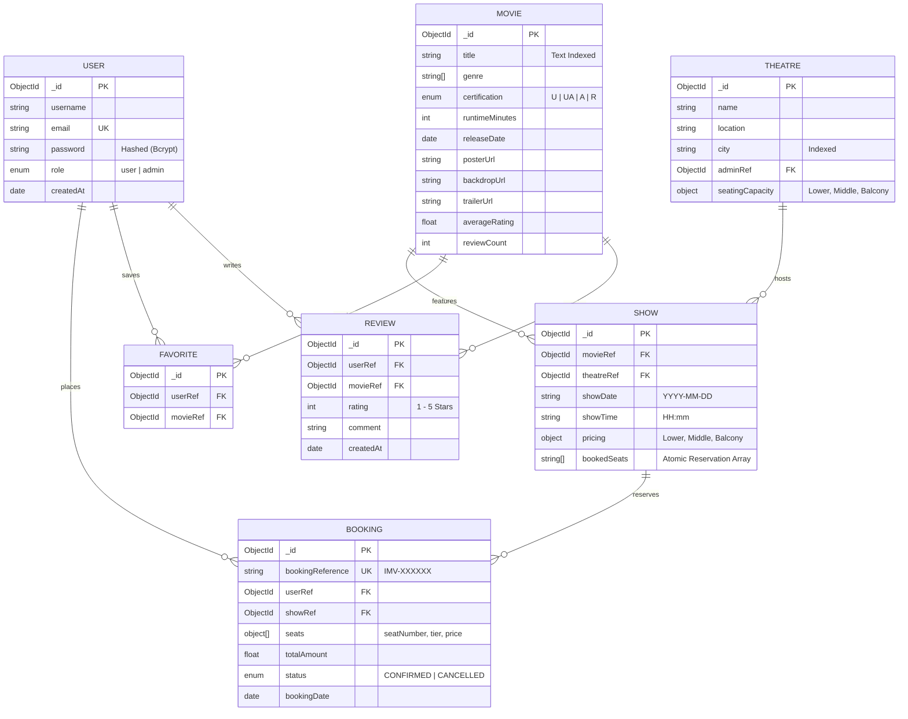

# 🎬 iMovies — Online Movie Ticket Booking Platform

[](https://opensource.org/licenses/MIT)
[](https://nodejs.org/)
[](https://expressjs.com/)
[](https://www.mongodb.com/)
[]()
[]()

> An enterprise-grade, full-stack cinema discovery and online ticket reservation platform built with Node.js, Express, MongoDB, and the **Ticketnew Light** design system. Engineered with atomic concurrency controls to eliminate double-booking race conditions during high-demand movie premieres.

---

## 📑 Table of Contents

1. [Project Overview](#-project-overview)
2. [System Architecture](#-system-architecture)
3. [Domain Model & ER Diagram](#-domain-model--er-diagram)
4. [Concurrency & Race-Condition Prevention](#-concurrency--race-condition-prevention)
5. [Design System: Ticketnew Light](#-design-system-ticketnew-light)
6. [Complete REST API Reference](#-complete-rest-api-reference)
7. [Repository & Directory Structure](#-repository--directory-structure)
8. [Installation & Local Setup](#-installation--local-setup)
9. [Documentation Deliverables](#-documentation-deliverables)
10. [Scalability & Future Roadmap](#-scalability--future-roadmap)
11. [License & Acknowledgments](#-license--acknowledgments)

---

## 🎯 Project Overview

**iMovies** bridges cinema lovers with modern theatres through a friction-free, utility-first digital ticketing experience. It provides movie discovery, hall showtime schedules, interactive tiered seat selection, instant reservation management, and community reviews.

### Core User Personas
- **The Moviegoer**: Discovers trending releases, filters by genre and language, selects seats across seating tiers (Balcony, Middle, Lower), receives instant digital ticket receipts, and manages a personal watchlist.
- **The Cinema Administrator**: Configures theatre halls, schedules collision-free screenings, monitors real-time revenue KPIs, and audits bookings across the platform.
- **The Technical Reviewer / Auditor**: Inspects the codebase against industry benchmarks for data normalization, token security (JWT & Bcrypt), and concurrent booking consistency.

---

## 🏛️ System Architecture

iMovies implements a **modular, decoupled monolith architecture** with distinct layers for routing, request validation, business logic controllers, database persistence, and a lightweight client presentation tier.



---

## 📊 Domain Model & ER Diagram

The domain model enforces referential integrity using canonical MongoDB `ObjectId` bindings rather than loose string identifiers. Compound unique indexes ensure relational consistency at the database level.



### Key Database Design Principles
1. **Unified Identity Model**: User and Administrator accounts share a single schema differentiated by `role: 'user' | 'admin'`, eliminating duplicate authentication pipelines.
2. **Compound Unique Indexes**:
   - `Favorite`: `{ user: 1, movie: 1 }` (guarantees a user cannot favorite a film more than once).
   - `Review`: `{ user: 1, movie: 1 }` (enforces one review per user per movie).
   - `Show`: `{ theatre: 1, showDate: 1, showTime: 1 }` (guarantees zero hall schedule overlaps).

---

## ⚡ Concurrency & Race-Condition Prevention

### The Problem: Naive Check-Then-Insert Race Conditions
In high-demand ticket sales, multiple concurrent requests attempting to book the identical seat (e.g., `M-5`) can cause disastrous double-bookings if implemented with naive sequential reads and writes:

```javascript
// ❌ NAIVE (BUGGY) APPROACH - RESULTS IN DOUBLE BOOKING:
const show = await Show.findById(showId);
if (show.bookedSeats.includes('M-5')) {
  return res.status(400).send("Seat already booked");
}
// Concurrency gap: Thread B reads here before Thread A finishes saving!
show.bookedSeats.push('M-5');
await show.save();
```

### The Solution: Database-Level Atomic Conditional Updates
iMovies leverages MongoDB's atomic single-document operations. By using the `$nin` query filter alongside `$push`, seat checking and reservation occur in a single atomic database operation:

```javascript
// ✅ ATOMIC & RACE-CONDITION-FREE BOOKING LOGIC:
const updatedShow = await Show.findOneAndUpdate(
  {
    _id: showId,
    // Condition: ALL requested seats must NOT currently exist in bookedSeats
    bookedSeats: { $nin: selectedSeats }
  },
  {
    // Atomically append selected seats into the reserved array
    $push: { bookedSeats: { $each: selectedSeats } }
  },
  { new: true }
);

if (!updatedShow) {
  // If no document matched the filter, another user claimed at least one seat
  return res.status(409).json({
    success: false,
    message: "Seat collision: One or more selected seats have already been booked. Please choose other seats.",
    error: { code: "SEAT_CONCURRENTLY_RESERVED" }
  });
}

// Seat reservation guaranteed; generate confirmed ticket record
const booking = await Booking.create({
  bookingReference: `IMV-${Math.floor(100000 + Math.random() * 900000)}`,
  user: req.user.id,
  show: showId,
  seats: seatDetails,
  totalAmount: calculatedTotal,
  status: 'CONFIRMED'
});
```

---

## 🎨 Design System: Ticketnew Light

The frontend follows the **Ticketnew Light** design specification: a utilitarian, low-contrast, light visual system optimized for fast ticket discovery and dense information layout.

| Token Group | Token Name | Value | Purpose |
|---|---|---|---|
| **Colors** | `--color-primary` | `#000000` | Strongest emphasis, active pill buttons, titles |
| | `--color-secondary` | `#545459` | Soft graphite body text and secondary metadata |
| | `--color-tertiary` | `rgba(0, 0, 0, 0.24)` | Translucent borders for chips and dividers |
| | `--color-surface` | `#FFFFFF` | Dominant white background for cards and controls |
| | `--color-border` | `#E5E7EB` | Soft structural gray outline |
| | `--color-error` | `#D92D20` | Validation errors, ticket cancellation |
| | `--color-bg-page` | `#F9FAFB` | Clean, calm background canvas |
| **Typography** | Font Family | `Be Vietnam Pro` | Sole typeface for consistent legibility |
| | Display / H1 | `32px / 700 / 38px` | Hero title |
| | Section / H2 | `24px / 700 / 29px` | Main section headings |
| | Card / H3 | `16px / 600 / 22px` | Movie card and venue titles |
| | Body Text | `14px / 400 / 20px` | Descriptions, metadata |
| | Label / Pill | `12px / 500 / 18px` | Interactive chips, tabs, seat buttons |
| **Shapes** | Card Radius | `8px` (`--rounded-md`) | Containers, input fields, modal dialogs |
| | Pill Radius | `9999px` (`--rounded-full`) | Chips, filter buttons, search tags |
| **Spacing** | Scale | `2px, 8px, 16px, 24px` | Strict adherence to compact visual density |

---

## 🔌 Complete REST API Reference

All API responses follow a unified JSON envelope:
```json
{
  "success": true,
  "message": "Human-readable description",
  "data": { ... }
}
```

### Authentication Endpoints
| Method | Endpoint | Access | Description |
|:---:|---|:---:|---|
| `POST` | `/api/auth/register` | Public | Register new customer account |
| `POST` | `/api/auth/login` | Public | Authenticate user/admin & return signed JWT token |
| `GET` | `/api/auth/profile` | Authenticated | Retrieve authenticated user profile |

### Movie Discovery Endpoints
| Method | Endpoint | Access | Description |
|:---:|---|:---:|---|
| `GET` | `/api/movies` | Public | List and search films with genre filters & pagination |
| `GET` | `/api/movies/:id` | Public | Retrieve detailed movie synopsis, rating, and showtimes |
| `POST` | `/api/movies` | Admin | Publish a new film to the platform catalog |
| `DELETE` | `/api/movies/:id` | Admin | Remove/Archive film from active screening |

### Theatres & Showtimes Endpoints
| Method | Endpoint | Access | Description |
|:---:|---|:---:|---|
| `GET` | `/api/theatres` | Public | List partner cinema venues, hall amenities, and capacities |
| `GET` | `/api/shows` | Public | Query shows filtered by `movieId` and `date` |
| `GET` | `/api/shows/:id/seats` | Public | Retrieve live cinema hall seating grid with booked seats |
| `POST` | `/api/shows` | Admin | Schedule a new screening with hall collision prevention |

### Booking & Ticket Endpoints
| Method | Endpoint | Access | Description |
|:---:|---|:---:|---|
| `POST` | `/api/bookings` | User | **Atomic reservation** of selected seats with receipt creation |
| `GET` | `/api/bookings/my-bookings` | User | Retrieve current user's active and historical tickets |
| `GET` | `/api/bookings/:id` | User/Admin | Retrieve single ticket receipt by ID |
| `PUT` | `/api/bookings/:id/cancel` | User | Cancel ticket reservation and release seats back to show |

### Favorites, Reviews & Admin Endpoints
| Method | Endpoint | Access | Description |
|:---:|---|:---:|---|
| `GET` | `/api/favorites` | User | Retrieve user's personal movie watchlist |
| `POST` | `/api/favorites/:movieId` | User | Toggle film in/out of favorites |
| `GET` | `/api/movies/:id/reviews` | Public | Retrieve reviews and ratings for a film |
| `POST` | `/api/reviews` | User | Submit rating (1-5) and review comment |
| `GET` | `/api/admin/stats` | Admin | Aggregated platform metrics (revenue, tickets, screenings) |
| `GET` | `/api/admin/bookings` | Admin | Comprehensive audit log of all system bookings |

---

## 📁 Repository & Directory Structure

```
d:/agent2/MovieTicket/
├── docs/                                # Technical Planning & Architecture Documentation
│   ├── iMovies_Project_Plan.pdf         # 22-page publication-quality master PDF plan
│   ├── iMovies_Project_Plan.md          # Comprehensive architectural specification
│   ├── iMovies_Project_Plan.html        # Styled source HTML for PDF compilation
│   └── build_pdf.py                     # Automated PDF build pipeline
├── public/                              # Frontend Client Tier (Ticketnew Light)
│   ├── index.html                       # Semantic HTML5 markup
│   ├── css/
│   │   └── style.css                    # Ticketnew Light tokens & components
│   └── js/
│       └── app.js                       # Client controller, seat selector & REST fetchers
├── server.js                            # Express backend REST API & mock data store
├── package.json                         # Project metadata, dependencies & scripts
├── package-lock.json                    # Locked dependency tree
├── .gitignore                           # Excluded artifacts (node_modules, .env)
└── README.md                            # Master project documentation
```

---

## 🚀 Installation & Local Setup

### 1. Prerequisites
- **Node.js**: `v18.x` or `v20.x LTS`
- **npm**: `v9.x` or higher
- **Modern Web Browser**: Chrome, Edge, Safari, or Firefox

### 2. Clone the Repository
```bash
git clone https://github.com/PriyanshuRaj2077/2736IMovies.git
cd 2736IMovies
```

### 3. Install Dependencies
```bash
npm install
```

### 4. Configure Environment (Optional)
Create a `.env` file in the root directory:
```env
PORT=5000
NODE_ENV=development
JWT_SECRET=super_secret_jwt_key_min_32_chars_long
CLIENT_ORIGIN=http://localhost:5000
```

### 5. Launch the Platform
```bash
# Start local development server
npm start
# or
npm run dev
```

The application will be live at:
- **Interactive Web App**: [http://localhost:5000](http://localhost:5000)
- **REST API Endpoint**: [http://localhost:5000/api/movies](http://localhost:5000/api/movies)
- **Project Plan (HTML)**: [http://localhost:5000/docs/iMovies_Project_Plan.html](http://localhost:5000/docs/iMovies_Project_Plan.html)

---

## 📑 Documentation Deliverables

Detailed engineering specifications are available in the [`docs/`](docs/) directory:

- 📄 **[iMovies Master Project Plan (PDF)](docs/iMovies_Project_Plan.pdf)**: Comprehensive 22-page document compiled via headless browser with styled cover page, system diagrams, and task breakdowns.
- 📝 **[iMovies Project Plan (Markdown)](docs/iMovies_Project_Plan.md)**: Full architectural specification and implementation guide.

---

## 🔮 Scalability & Future Roadmap

1. **Payment Gateway Integration**: Webhook-driven two-phase commit with Stripe or Razorpay for automated payment capture and refunds.
2. **WebSocket Live Seat Sync**: Real-time seat locking broadcasted via Socket.IO so users see seats occupied in real time.
3. **Automated Notification Service**: Asynchronous background queue for emailing PDF ticket confirmations via Nodemailer / SendGrid.
4. **Microservices Decomposition**: Decoupling the monolith into `auth-service`, `catalog-service`, and `booking-engine` coordinated via Apache Kafka as transaction volume scales beyond 10,000 req/min.

---

## 📄 License & Acknowledgments

This project is licensed under the **MIT License**.

Developed under the **iMovies** initiative.
Architected and designed with the **Ticketnew Light** design language.
