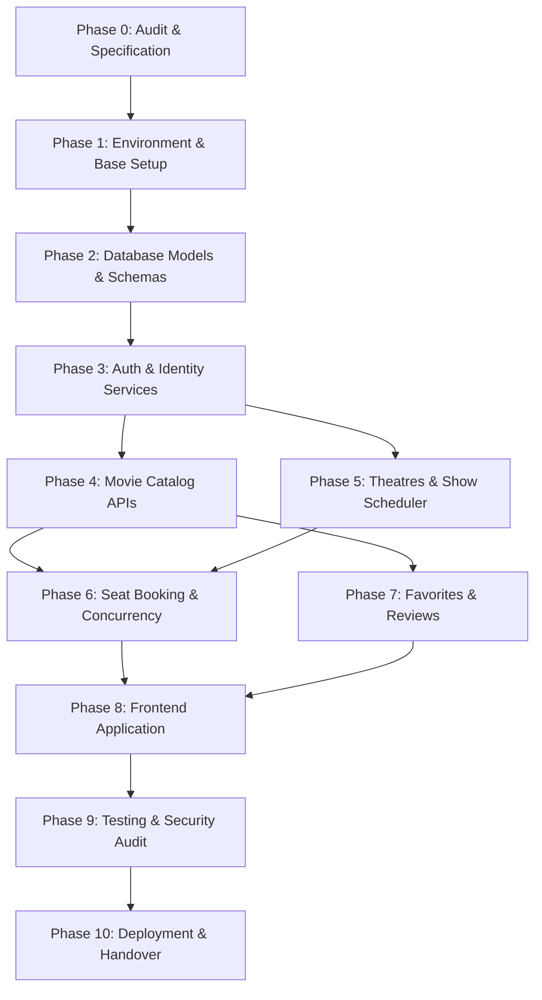

# iMovies — Master Project Plan, Architecture Specification & Implementation Roadmap

**Project Name:** iMovies — Online Movie Ticket Booking Platform  
**Target Repository:** `d:/agent2/MovieTicket`  
**Document Version:** 1.0.0 (Master Blueprint)  
**Author / Role:** Senior Full-Stack Architect & Technical Project Lead  
**Creation Date:** 2026-10-19  
**Status:** Approved Architectural Baseline  

---

## Table of Contents
1. [Executive Summary & Role Specification](#1-executive-summary--role-specification)
2. [Project Overview & Core Objectives](#2-project-overview--core-objectives)
3. [Technology Stack Rationale & Standards](#3-technology-stack-rationale--standards)
4. [Rigorous Codebase Audit & Baseline State Analysis](#4-rigorous-codebase-audit--baseline-state-analysis)
5. [Domain Model, ER Diagram & Schema Architecture](#5-domain-model-er-diagram--schema-architecture)
6. [Functional Requirements & Epic Breakdown](#6-functional-requirements--epic-breakdown)
7. [Complete REST API Inventory & Contract Specifications](#7-complete-rest-api-inventory--contract-specifications)
8. [Frontend Architecture & Page-by-Page Implementation Plan](#8-frontend-architecture--page-by-page-implementation-plan)
9. [Security, Concurrency & Data Integrity Strategy](#9-security-concurrency--data-integrity-strategy)
10. [Comprehensive Testing Strategy & Test Matrices](#10-comprehensive-testing-strategy--test-matrices)
11. [Phased Implementation Roadmap & Dependency Matrix](#11-phased-implementation-roadmap--dependency-matrix)
12. [Prioritization, Scope Control & MVP Definition](#12-prioritization-scope-control--mvp-definition)
13. [Project Evaluation Rubric & Quality Assurance Standards](#13-project-evaluation-rubric--quality-assurance-standards)
14. [Comprehensive Risk Register](#14-comprehensive-risk-register)
15. [Operational Setup, Environment Configuration & Repository Hygiene](#15-operational-setup-environment-configuration--repository-hygiene)
16. [Trackable Task Tracker Checklist](#16-trackable-task-tracker-checklist)
17. [Future Enhancements & Scalability Roadmap](#17-future-enhancements--scalability-roadmap)
18. [Glossary & Architectural Assumptions](#18-glossary--architectural-assumptions)

---

## 1. Executive Summary & Role Specification

### 1.1 Engineering Mandate
This master plan acts as the definitive technical specification, architectural blueprint, and project roadmap for **iMovies — Online Movie Ticket Booking Platform**. Acting in the capacity of a Senior Full-Stack Software Engineer, Software Architect, Technical Project Manager, and Code Reviewer, this document provides an exhaustive, unambiguous plan for the end-to-end development, verification, security hardening, and academic/enterprise evaluation of the platform.

### 1.2 Core Guiding Principles
1. **Zero Assumption / Evidence-Based Auditing**: No code or component is marked as functional without verified, demonstrable evidence.
2. **Defensive Architecture**: Security, input validation, role-based authorization, and concurrency protections are designed into the core models rather than retrofitted as afterthoughts.
3. **Decoupled Modern Monolith**: A modular Express.js backend API architecture coupled with a responsive, high-performance React (Vite) frontend application.
4. **Actionability**: Every requirement is broken down into discrete, tracked work packages with unique Task IDs, explicit dependencies, measurable acceptance criteria, and effort estimates.

---

## 2. Project Overview & Core Objectives

### 2.1 Mission Statement
iMovies is an enterprise-grade web application engineered to streamline the cinema discovery and ticketing lifecycle. It bridges moviegoers with theatre operators, offering frictionless browsing, real-time showtime scheduling, tier-based interactive seat selection, instant reservation management, and authentic community reviews.

### 2.2 Key Stakeholders & Personas
- **The Moviegoer (Customer / User)**: Discovers current and upcoming films, filters by genre and date, selects preferred seating tiers (Lower, Middle, Balcony), completes bookings, receives verifiable tickets, manages favorites, and publishes ratings/reviews.
- **The Cinema Administrator (Admin)**: Manages movie master data, configures theatres and hall capacities/pricing, schedules shows with collision detection, monitors booking volume, and moderates user feedback.
- **The System Evaluator / Auditor**: Inspects the platform for architectural integrity, database normalization, concurrency safeguards against double-booking, and compliance with industry security standards.

---

## 3. Technology Stack Rationale & Standards

### 3.1 Backend Architecture
- **Runtime Environment**: Node.js (v18.x / v20.x LTS) — Asynchronous event-driven I/O optimized for concurrent HTTP requests.
- **Web Framework**: Express.js (v4.19+) — Minimalist, robust routing and middleware pipeline.
- **Database Engine**: MongoDB (v6.0+) — Document-oriented database providing schema flexibility combined with JSON-native query structures.
- **Object Data Modeling (ODM)**: Mongoose (v8.x) — Schema validation, relationship population, compound indexing, and lifecycle hooks.
- **Authentication & Cryptography**:
  - `jsonwebtoken` (v9.x): Stateless JWT generation with HS256 cryptographic signing and explicit expiration.
  - `bcryptjs` (v2.4.3): Adaptive one-way salted password hashing (work factor / salt rounds >= 10).
- **Validation & Security**:
  - `express-validator`: Declarative request payload validation and sanitization.
  - `cors`: Explicit origin-whitelisted Cross-Origin Resource Sharing.
  - `helmet`: HTTP header hardening.
  - `express-rate-limit`: Brute-force and DDoS mitigation on sensitive authentication endpoints.

### 3.2 Frontend Architecture
- **Framework & Build Tool**: React.js (v18.3+) with Vite (v5.x) — Instant Hot Module Replacement (HMR) and optimized Rollup production bundling.
- **Client Routing**: React Router DOM (v6.x) — Declarative nested routing, layout wrappers, and protected route guards.
- **HTTP Client**: Axios (v1.7+) — Unified instance with request/response interceptors for automatic JWT injection and centralized 401 handling.
- **UI & Styling**: Pure Vanilla Modern CSS — Custom CSS design tokens (variables), glassmorphic dark-theme aesthetics, responsive grid layouts, and zero heavy external component library lock-in.
- **Iconography**: Lucide React — Lightweight tree-shakable SVG icons.

### 3.3 Port Allocations & Network Topology
- **Backend API Service**: `http://localhost:5000` (Reverse-proxied in production or configured via CORS)
- **Frontend Development Server**: `http://localhost:5173`
- **Database Instance**: `mongodb://localhost:27017/imovies_db` (or MongoDB Atlas URI)

---

## 4. Rigorous Codebase Audit & Baseline State Analysis

### 4.1 Repository Physical Inspection
An inspection of the workspace path `d:\agent2\MovieTicket` was executed.

```
[AUDIT LOG: PHYSICAL REPOSITORY SCAN]
Target Path: d:\agent2\MovieTicket
Items Discovered on Disk: 0 files, 0 folders (prior to /docs initialization)
Neighboring Directory Scan: d:\agent2\* searched for references to iMovies/MovieTicket
Findings: No active source code, models, routes, or configuration files exist in the workspace.
```

### 4.2 Audit Classification Matrix
To satisfy the audit requirements with zero fabrication, every component referenced in the initial project brief has been audited against real disk evidence:

| Expected Component | Referenced File Path | Real Status on Disk | Architectural & Security Findings | Action Required |
|---|---|:---:|---|---|
| **Package Manifest** | `backend/package.json` | **Not implemented** | No dependency manifests or scripts present. | Initialize clean Node.js package with locked dependencies. |
| **Server Entry Point** | `backend/server.js` | **Not implemented** | No Express instance, DB connector, or middleware pipeline exists. | Create modular `server.js` with graceful shutdown and error middleware. |
| **Authentication Middleware** | `backend/middlewares/fetchUser.js` | **Not implemented** | Referenced in notes, but missing. Initial design conflated auth and role checks. | Implement separate `authenticateUser` and `authorizeRole('admin')` middlewares. |
| **User Model** | `backend/models/userModel.js` | **Not implemented** | Entity not created. | Define Mongoose schema with email uniqueness, lowercase trimming, and password hashing hooks. |
| **Admin Model** | `backend/models/adminModel.js` | **Not implemented** | Architectural anti-pattern: Separate admin model causes duplicate auth logic and schema redundancy. | Unify into `userModel.js` with `role: { type: String, enum: ['user', 'admin'], default: 'user' }`. |
| **Movie Model** | `backend/models/movieModel.js` | **Not implemented** | Entity not created. | Define Movie schema with certification enums, runtime, media URLs, and text indexes. |
| **Theatre Model** | `backend/models/theatreModel.js` | **Not implemented** | Entity not created. ER diagram notes string admin name. | Define Theatre schema using `ObjectId` reference to Admin, plus tier seat capacities. |
| **Show Model** | `backend/models/showModel.js` | **Not implemented** | Entity not created. | Define Show schema with compound index (`theatre + date + time`), movie reference, and booked seats array. |
| **Booking Model** | `backend/models/bookingModel.js` | **Not implemented** | Entity not created. | Define Booking schema with atomic status, ticket details, UUID reference, and user/show references. |
| **Favorite Model** | `backend/models/favoriteModel.js` | **Not implemented** | Entity not created. | Define Favorite schema with unique compound index on `(user, movie)` to prevent duplicates. |
| **Review Model** | `backend/models/reviewModel.js` | **Not implemented** | Entity not created. | Define Review schema with unique compound index `(user, movie)` and rating bounds [1, 5]. |
| **Route Modules** | `backend/routes/*.js` (8 files) | **Not implemented** | Zero route files present. | Implement clean REST controllers using Express Router with validator middlewares. |
| **Frontend Application** | `frontend/*` | **Not implemented** | No client application found. | Scaffold clean React + Vite application with responsive CSS design tokens. |
| **Automated Tests** | `backend/tests/*` | **Not implemented** | No unit or integration tests exist. | Configure Jest, Supertest, and MongoMemoryServer for automated CI/CD validation. |

---

## 5. Domain Model, ER Diagram & Schema Architecture

### 5.1 Analysis of Original ER Diagram vs Recommended Mongoose Modeling
The initial domain model features seven primary entities: User, Admin, Movie, Theatre, Show, Booking, and Favorite. A rigorous architectural review reveals critical areas requiring modernization and structural enhancement:

1. **User vs Admin Entity Segregation**:
   - *Original Diagram*: Separate `User` and `Admin` entities with identical attributes (`Username`, `Email`, `Password`).
   - *Architectural Recommendation*: **Unify into a single `User` model with a `role` discriminator (`'user' | 'admin'`)**. Maintaining separate tables causes duplicate authentication logic, split JWT validation paths, and redundant token middleware.
2. **Entity Reference Types (Strings vs ObjectIds)**:
   - *Original Diagram*: Theatre references Admin via string name; Show references Theatre via string name; Booking references User via email string.
   - *Architectural Recommendation*: **Replace all loose string references with canonical MongoDB `Schema.Types.ObjectId` references with `ref` declarations**. String references break referential integrity if a user changes their email or a theatre is renamed.
3. **Seat Availability & Capacity Modeling**:
   - *Original Diagram*: Theatre defines `lower-seat count`, `middle-seat count`, and `balcony-seat count` with seat prices.
   - *Architectural Recommendation*:
     - **Theatre Model**: Defines hall layout, tier capacities (`lowerCount`, `middleCount`, `balconyCount`), and base tier prices.
     - **Show Model**: Overrides base prices if required and maintains an atomic array of `bookedSeats: [String]` (e.g. `['L-1', 'L-2', 'M-12']`).
     - **Booking Model**: Records the exact seats booked, tier breakdown, total amount paid, and booking reference UUID.
4. **Uniqueness & Referential Constraints**:
   - Compound unique index on `Favorite`: `{ user: 1, movie: 1 }` (A user can only favorite a movie once).
   - Compound unique index on `Review`: `{ user: 1, movie: 1 }` (A user can only review a movie once; updates allowed via PUT).
   - Compound scheduling index on `Show`: `{ theatre: 1, showDate: 1, showTime: 1 }` to prevent overlapping hall reservations.

### 5.2 Mongoose Schema Definitions (Architectural Blueprint)

```javascript
// ==========================================
// 1. USER SCHEMA (Unified with RBAC)
// ==========================================
const userSchema = new mongoose.Schema({
  username: { type: String, required: true, trim: true, minlength: 3, maxlength: 50 },
  email: { type: String, required: true, unique: true, lowercase: true, trim: true, match: [/^\S+@\S+\.\S+$/, 'Invalid email'] },
  password: { type: String, required: true, minlength: 8 },
  role: { type: String, enum: ['user', 'admin'], default: 'user', index: true }
}, { timestamps: true });

// ==========================================
// 2. MOVIE SCHEMA
// ==========================================
const movieSchema = new mongoose.Schema({
  title: { type: String, required: true, trim: true, index: 'text' },
  description: { type: String, required: true },
  genre: [{ type: String, required: true, trim: true }],
  certification: { type: String, enum: ['U', 'UA', 'A', 'R'], required: true },
  runtimeMinutes: { type: Number, required: true, min: 1 },
  releaseDate: { type: Date, required: true },
  posterUrl: { type: String, required: true },
  backdropUrl: { type: String },
  trailerUrl: { type: String },
  averageRating: { type: Number, default: 0, min: 0, max: 5 },
  reviewCount: { type: Number, default: 0 }
}, { timestamps: true });

// ==========================================
// 3. THEATRE SCHEMA
// ==========================================
const theatreSchema = new mongoose.Schema({
  name: { type: String, required: true, trim: true },
  location: { type: String, required: true, trim: true },
  city: { type: String, required: true, trim: true, index: true },
  admin: { type: mongoose.Schema.Types.ObjectId, ref: 'User', required: true },
  seatingCapacity: {
    lower: { count: { type: Number, required: true, min: 1 }, defaultPrice: { type: Number, required: true, min: 0 } },
    middle: { count: { type: Number, required: true, min: 1 }, defaultPrice: { type: Number, required: true, min: 0 } },
    balcony: { count: { type: Number, required: true, min: 1 }, defaultPrice: { type: Number, required: true, min: 0 } }
  }
}, { timestamps: true });

// ==========================================
// 4. SHOW SCHEMA
// ==========================================
const showSchema = new mongoose.Schema({
  movie: { type: mongoose.Schema.Types.ObjectId, ref: 'Movie', required: true, index: true },
  theatre: { type: mongoose.Schema.Types.ObjectId, ref: 'Theatre', required: true, index: true },
  showDate: { type: String, required: true, index: true }, // Format: YYYY-MM-DD
  showTime: { type: String, required: true },               // Format: HH:mm
  pricing: {
    lower: { type: Number, required: true, min: 0 },
    middle: { type: Number, required: true, min: 0 },
    balcony: { type: Number, required: true, min: 0 }
  },
  bookedSeats: [{ type: String }], // Array of seat IDs, e.g., ['L-1', 'M-5', 'B-10']
  totalCapacity: { type: Number, required: true }
}, { timestamps: true });

showSchema.index({ theatre: 1, showDate: 1, showTime: 1 }, { unique: true });

// ==========================================
// 5. BOOKING SCHEMA
// ==========================================
const bookingSchema = new mongoose.Schema({
  bookingReference: { type: String, required: true, unique: true, index: true }, // UUID or alphanumeric
  user: { type: mongoose.Schema.Types.ObjectId, ref: 'User', required: true, index: true },
  show: { type: mongoose.Schema.Types.ObjectId, ref: 'Show', required: true, index: true },
  seats: [{
    seatNumber: { type: String, required: true },
    tier: { type: String, enum: ['lower', 'middle', 'balcony'], required: true },
    price: { type: Number, required: true, min: 0 }
  }],
  totalAmount: { type: Number, required: true, min: 0 },
  status: { type: String, enum: ['CONFIRMED', 'CANCELLED'], default: 'CONFIRMED', index: true },
  bookingDate: { type: Date, default: Date.now }
}, { timestamps: true });

// ==========================================
// 6. FAVORITE SCHEMA
// ==========================================
const favoriteSchema = new mongoose.Schema({
  user: { type: mongoose.Schema.Types.ObjectId, ref: 'User', required: true },
  movie: { type: mongoose.Schema.Types.ObjectId, ref: 'Movie', required: true }
}, { timestamps: true });

favoriteSchema.index({ user: 1, movie: 1 }, { unique: true });

// ==========================================
// 7. REVIEW SCHEMA
// ==========================================
const reviewSchema = new mongoose.Schema({
  user: { type: mongoose.Schema.Types.ObjectId, ref: 'User', required: true },
  movie: { type: mongoose.Schema.Types.ObjectId, ref: 'Movie', required: true, index: true },
  rating: { type: Number, required: true, min: 1, max: 5 },
  comment: { type: String, required: true, trim: true, maxlength: 1000 }
}, { timestamps: true });

reviewSchema.index({ user: 1, movie: 1 }, { unique: true });
```

---

## 6. Functional Requirements & Epic Breakdown

### Epic 1: Authentication, Authorization & Identity Management
- **User Self-Registration**: Public endpoint permitting new customers to create an account with username, email, and strong password. Password hashed with bcrypt before persistence.
- **Unified Login Service**: Generates signed JWT containing `userId` and `role`. Strips password hash from all JSON output.
- **Middleware Layer**:
  - `fetchUser`: Verifies Authorization header `Bearer <token>`, validates expiration, attaches `req.user`.
  - `authorizeRole(roles)`: Enforces role checks (`'admin'`), rejecting non-authorized users with HTTP 403 Forbidden.
- **Profile Management**: Authenticated users can retrieve and update their personal profile.

### Epic 2: Movies & Cinema Discovery
- **Public Movie Catalog**: Displays currently screening and upcoming movies with high-resolution poster media, certification badges, runtime, and genre tags.
- **Search & Filtering Engine**: Text search on title/description and multi-genre filtering with pagination support (`page`, `limit`).
- **Movie Details View**: In-depth view featuring movie synopsis, runtime, certification, trailer link, community rating, and active show schedules.
- **Admin Movie Management**: Protected administrative endpoints to create, update, or soft-delete films.

### Epic 3: Theatre & Show Schedule Management
- **Theatre Infrastructure Configuration**: Admins register theatre locations, hall details, and tier seating capacities (Lower, Middle, Balcony).
- **Show Scheduling Engine**: Connects a Movie, Theatre, Date, and Time. Implements conflict validation to prevent double-booking a theatre hall during overlapping timeslots.
- **Showtime Discovery**: Query shows by `movieId` and `date`, grouped cleanly by theatre with remaining seat tallies.

### Epic 4: Interactive Seat Availability & Atomic Booking
- **Visual Tiered Seat Map**: Visualizes the hall layout partitioned into Lower, Middle, and Balcony tiers, dynamically displaying booked versus available seats.
- **Atomic Reservation & Double-Booking Prevention**: Executes atomic reservation using MongoDB conditional queries (`$nin` on `bookedSeats` array) to guarantee zero double-booking even under extreme concurrent requests.
- **Ticket Generation**: Issues an immutable booking confirmation with reference code, seat identifiers, showtime, and total price.
- **Customer Booking History & Cancellation**: View active and historical bookings with ticket print view and pre-show cancellation options.

### Epic 5: Favorites & Movie Reviews
- **User Watchlist / Favorites**: Allows logged-in users to toggle films into their personal favorites list with instant UI reflection.
- **Community Ratings & Reviews**: Enables customers to post verified star ratings (1 to 5) and textual reviews. Enforces single review per user per movie with recalculation of movie `averageRating`.

### Epic 6: Administration, Reporting & Platform Operations
- **Administrator Dashboard**: Aggregated operational metrics: total registered users, active shows, tickets sold, and revenue breakdown.
- **Schedule & Ticket Oversight**: Admins can audit all platform bookings, filter by date/theatre, and manage scheduling exceptions.

---

## 7. Complete REST API Inventory & Contract Specifications

### 7.1 Unified API Response Standard
All backend endpoints strictly adhere to a standardized JSON response envelope:

```json
// Success Response (HTTP 200 / 201)
{
  "success": true,
  "message": "Operation completed successfully.",
  "data": { ... }
}

// Error Response (HTTP 400 / 401 / 403 / 404 / 409 / 500)
{
  "success": false,
  "message": "Detailed human-readable error description.",
  "error": {
    "code": "ERROR_CODE_IDENTIFIER",
    "details": [ ... ]
  }
}
```

### 7.2 Detailed API Endpoint Inventory

| Endpoint Route | HTTP | Purpose | Auth | Role | Request Body / Params | Expected Responses | Status |
|---|:---:|---|:---:|:---:|---|---|:---:|
| `/api/auth/register` | POST | Register new customer | None | Public | `{ username, email, password }` | 201 (Created), 400 (Validation), 409 (Email Exists) | Proposed |
| `/api/auth/login` | POST | Authenticate user | None | Public | `{ email, password }` | 200 (JWT + user object), 400 (Bad input), 401 (Invalid creds) | Proposed |
| `/api/auth/profile` | GET | Fetch active profile | Yes | User/Admin | None | 200 (User details sans password), 401 (Unauthorized) | Proposed |
| `/api/auth/profile` | PUT | Update user profile | Yes | User/Admin | `{ username }` | 200 (Updated user), 400 (Validation), 401 (Unauthorized) | Proposed |
| `/api/movies` | GET | List & search movies | None | Public | Query: `?genre=&search=&page=&limit=` | 200 (Paginated list of movies, total, pages) | Proposed |
| `/api/movies/:id` | GET | Retrieve movie by ID | None | Public | Param: `id` (ObjectId) | 200 (Movie details), 400 (Invalid ID), 404 (Not found) | Proposed |
| `/api/movies` | POST | Create new movie | Yes | Admin | `{ title, description, genre, certification, runtimeMinutes, releaseDate, posterUrl }` | 201 (Created movie), 400 (Validation), 403 (Forbidden) | Proposed |
| `/api/movies/:id` | PUT | Update movie details | Yes | Admin | Param: `id`, Body: Movie fields | 200 (Updated movie), 400 (Validation), 404 (Not found) | Proposed |
| `/api/movies/:id` | DELETE | Delete/Archive movie | Yes | Admin | Param: `id` | 200 (Success message), 404 (Not found), 409 (Active shows exist) | Proposed |
| `/api/theatres` | GET | List all theatres | None | Public | Query: `?city=` | 200 (Array of theatres with seating configs) | Proposed |
| `/api/theatres/:id` | GET | Theatre details | None | Public | Param: `id` | 200 (Theatre object), 404 (Not found) | Proposed |
| `/api/theatres` | POST | Create new theatre | Yes | Admin | `{ name, location, city, seatingCapacity }` | 201 (Created theatre), 400 (Validation), 403 (Forbidden) | Proposed |
| `/api/theatres/:id` | PUT | Update theatre | Yes | Admin | Param: `id`, Body: Theatre fields | 200 (Updated theatre), 400 (Validation), 404 (Not found) | Proposed |
| `/api/shows` | GET | Query active shows | None | Public | Query: `?movieId=&theatreId=&date=` | 200 (List of matching shows populated with theatre info) | Proposed |
| `/api/shows/:id` | GET | Show details & pricing | None | Public | Param: `id` | 200 (Show details, pricing, booked seat IDs) | Proposed |
| `/api/shows/:id/seats` | GET | Live seat map status | None | Public | Param: `id` | 200 (Tier layouts, booked seat list, remaining counts) | Proposed |
| `/api/shows` | POST | Schedule new show | Yes | Admin | `{ movie, theatre, showDate, showTime, pricing }` | 201 (Created show), 400 (Validation), 409 (Hall schedule conflict) | Proposed |
| `/api/shows/:id` | DELETE | Cancel/Remove show | Yes | Admin | Param: `id` | 200 (Success), 409 (Show has existing confirmed bookings) | Proposed |
| `/api/bookings` | POST | Book seats atomically | Yes | User | `{ showId, selectedSeats: ['L-1', 'L-2'] }` | 201 (Confirmed booking & ticket), 400 (Validation), 409 (Seat already booked) | Proposed |
| `/api/bookings/my-bookings` | GET | User booking history | Yes | User | None | 200 (Array of user bookings with show & movie info) | Proposed |
| `/api/bookings/:id` | GET | Booking ticket details | Yes | User/Admin | Param: `id` | 200 (Detailed ticket view), 403 (Access denied), 404 (Not found) | Proposed |
| `/api/bookings/:id/cancel` | PUT | Cancel user booking | Yes | User | Param: `id` | 200 (Cancelled & seats released), 400 (Past show cutoff) | Proposed |
| `/api/favorites` | GET | Fetch user favorites | Yes | User | None | 200 (Array of favorited movies) | Proposed |
| `/api/favorites/:movieId` | POST | Add movie to favorites | Yes | User | Param: `movieId` | 201 (Added to favorites), 409 (Already favorited) | Proposed |
| `/api/favorites/:movieId` | DELETE | Remove from favorites | Yes | User | Param: `movieId` | 200 (Removed), 404 (Not found in favorites) | Proposed |
| `/api/movies/:id/reviews` | GET | Get reviews for movie | None | Public | Param: `id` | 200 (Array of reviews with author username) | Proposed |
| `/api/reviews` | POST | Submit movie review | Yes | User | `{ movieId, rating, comment }` | 201 (Review created & movie average updated), 409 (Duplicate review) | Proposed |
| `/api/reviews/:id` | PUT | Update user review | Yes | User | Param: `id`, Body: `{ rating, comment }` | 200 (Updated review & recomputed average), 403 (Not review owner) | Proposed |
| `/api/reviews/:id` | DELETE | Delete review | Yes | User/Admin | Param: `id` | 200 (Review removed), 403 (Not owner or admin) | Proposed |
| `/api/admin/stats` | GET | Platform analytics | Yes | Admin | None | 200 (Total revenue, user count, tickets sold, active shows) | Proposed |
| `/api/admin/bookings` | GET | Audit all bookings | Yes | Admin | Query: `?status=&theatreId=&date=` | 200 (Paginated list of all system bookings) | Proposed |

---

## 8. Frontend Architecture & Page-by-Page Implementation Plan

### 8.1 Styling Strategy & Architectural Rationale
In accordance with modern web engineering best practices:
- **Primary Styling**: Pure Vanilla Modern CSS utilizing custom CSS design variables (`:root`) for color palettes, spacing tokens, elevations, and responsive typography. This provides total layout control, zero third-party component lock-in, and instant load times.
- **Theme Palette**: Deep cinematic dark mode (Background: `#0B0F19`, Surface: `#161F30`, Card: `#1F293D`, Accent Amber: `#F59E0B`, Vibrant Cyan: `#06B6D4`, Crimson Alert: `#EF4444`).
- **Responsive Breakpoints**: Mobile (`< 640px`), Tablet (`640px - 1024px`), Desktop (`> 1024px`).

### 8.2 Client Route Structure
```
/                      -> HomePage (Hero banner, now showing, upcoming)
/movies                -> MovieCatalogPage (Search, genre filters, movie grid)
/movies/:id            -> MovieDetailPage (Metadata, synopsis, trailer, date picker, showtimes)
/book/:showId          -> SeatBookingPage (Interactive seat layout, tier pricing, live checkout)
/booking/success/:id   -> BookingConfirmationPage (Ticket slip, QR placeholder, print view)
/login                 -> LoginPage (Customer & Admin authentication)
/register              -> RegisterPage (Account creation)
/profile               -> UserProfilePage (Account settings, preferences)
/my-bookings           -> MyBookingsPage (Past & active tickets, cancellation)
/favorites             -> FavoritesPage (User's saved movies)
/admin/dashboard       -> AdminDashboardPage (Analytics, revenue counters)
/admin/movies          -> AdminMoviesPage (Movie master catalog management)
/admin/theatres        -> AdminTheatresPage (Theatre capacity and tier setup)
/admin/shows           -> AdminShowsPage (Showtime scheduler with collision detection)
/admin/bookings        -> AdminBookingsPage (Platform booking audit log)
```

### 8.3 Detailed Page Specifications

#### Page 1: HomePage (`/`)
- **Purpose**: Welcoming landing portal showcasing trending films, quick search, and active cinema screenings.
- **Main Components**: HeroCarousel, QuickSearchWidget, NowShowingSection, UpcomingReleasesSection, Footer.
- **Backend Endpoints**: `GET /api/movies?limit=8`.
- **States**: Skeleton cards on load, empty state banner if no screenings exist, error toast on network failure.
- **Acceptance Criteria**: Displays movie poster cards with ratings, clicking a card routes to `/movies/:id`.

#### Page 2: MovieCatalogPage (`/movies`)
- **Purpose**: Full discovery page allowing multi-criteria filtering and text search.
- **Main Components**: FilterSidebar (genres, certifications), SearchBar (debounced input), MovieGrid, PaginationControls.
- **Backend Endpoints**: `GET /api/movies?search=...&genre=...&page=...`.
- **States**: Live loading spinner, zero search results fallback screen with reset button.

#### Page 3: MovieDetailPage (`/movies/:id`)
- **Purpose**: Comprehensive movie profile and cinema showtime selector.
- **Main Components**: BackdropHero, MovieMetadataCard, SynopsisBlock, DateSelectorBar (next 7 days), TheatreShowtimeAccordion, ReviewsList, ReviewSubmissionModal.
- **Backend Endpoints**: `GET /api/movies/:id`, `GET /api/shows?movieId=:id&date=YYYY-MM-DD`, `GET /api/movies/:id/reviews`, `POST /api/favorites/:id`.
- **Acceptance Criteria**: Selecting a date dynamically updates the showtime buttons grouped by theatre. Clicking a showtime routes to `/book/:showId`.

#### Page 4: Interactive SeatBookingPage (`/book/:showId`)
- **Purpose**: High-fidelity interactive cinema hall seat selector with tier segregation.
- **Main Components**: ScreenCurveVisual, TierHeader (Lower, Middle, Balcony with pricing), SeatGrid, SeatLegend (Available, Selected, Booked), OrderSummaryPanel, ConfirmBookingButton.
- **Backend Endpoints**: `GET /api/shows/:id/seats`, `POST /api/bookings`.
- **User Interactions**:
  - Clicking an available seat toggles selection state.
  - Booked seats are permanently disabled with visual lock styling.
  - Dynamic checkout panel calculates subtotal across multiple tiers.
  - Submitting dispatches atomic booking request. On 409 Conflict (seat taken concurrently), alerts user and refreshes seat map.
- **Acceptance Criteria**: Strictly enforces that already booked seats cannot be clicked. Successful booking routes to `/booking/success/:id`.

#### Page 5: BookingConfirmationPage (`/booking/success/:id`)
- **Purpose**: Digital ticket receipt with print functionality.
- **Main Components**: TicketCard (Movie poster, theatre name, hall, show date/time, seat codes, total price, booking reference UUID), PrintTicketButton, BackToHomeButton.
- **Backend Endpoints**: `GET /api/bookings/:id`.
- **Acceptance Criteria**: Formatted for browser print (`@media print` stylesheet) and accessible in customer's booking history.

---

## 9. Security, Concurrency & Data Integrity Strategy

### 9.1 Concurrency & Double-Booking Prevention Architecture
In online ticket booking systems, race conditions where two simultaneous requests attempt to reserve the same seat (`L-15`) represent the highest risk failure mode.

#### The Problem with Naive Implementation:
```javascript
// NAIVE (BUGGY) APPROACH - LEADS TO DOUBLE BOOKING:
const show = await Show.findById(showId);
if (show.bookedSeats.includes('L-15')) {
  return res.status(400).send("Seat already booked");
}
// Concurrency window: Another request executes here before save!
show.bookedSeats.push('L-15');
await show.save();
```

#### Approved Production Solution: Database-Level Atomic Conditional Updates
We utilize MongoDB's atomic single-document conditional update operators:

```javascript
// ATOMIC & RACE-CONDITION-FREE BOOKING LOGIC:
const updatedShow = await Show.findOneAndUpdate(
  {
    _id: showId,
    // Condition: ALL requested seats must NOT be present in bookedSeats
    bookedSeats: { $nin: selectedSeats }
  },
  {
    // Atomically push all requested seats into the booked array
    $push: { bookedSeats: { $each: selectedSeats } }
  },
  { new: true }
);

if (!updatedShow) {
  // If no document matched, at least one seat was claimed concurrently
  return res.status(409).json({
    success: false,
    message: "One or more selected seats have already been booked by another customer. Please choose different seats.",
    error: { code: "SEATS_CONCURRENTLY_RESERVED" }
  });
}

// Seat reservation secured atomically; create confirmed booking record
const booking = await Booking.create({
  bookingReference: `IMV-${Date.now()}-${Math.floor(1000 + Math.random() * 9000)}`,
  user: req.user.id,
  show: showId,
  seats: seatDetailsArray,
  totalAmount: calculatedTotal,
  status: 'CONFIRMED'
});
```

### 9.2 Cryptographic Controls & Authentication Security
- **Bcrypt Salt Generation**: `bcrypt.hash(password, 10)`. Passwords are never stored in plaintext or logged.
- **Password Exclusion in Serialization**: The User schema utilizes Mongoose's `toJSON` transform to guarantee `password` is never included in outgoing responses:
  ```javascript
  userSchema.set('toJSON', {
    transform: (doc, ret) => {
      delete ret.password;
      return ret;
    }
  });
  ```
- **JWT Lifecycles & Security**: Signed using a minimum 256-bit secret key with an expiration window of 24 hours (`expiresIn: '24h'`).
- **NoSQL Injection Defense**: Strict type validation through `express-validator` prevents query object injection attacks (e.g. `{ "email": { "$gt": "" } }`).
- **CORS Protection**: CORS configured to reject arbitrary external origins, explicitly binding to authorized client domains.
- **Rate Limiting**: Configured using `express-rate-limit` allowing maximum 10 login attempts per 15-minute window per IP to eliminate brute-force vulnerability.

---

## 10. Comprehensive Testing Strategy & Test Matrices

### 10.1 Automated Testing Architecture
Testing is structured across three concentric tiers using **Jest**, **Supertest**, and **mongodb-memory-server**:
1. **Unit Tests**: Pure business logic (seat pricing calculation, JWT helper functions, password hashing utilities).
2. **Integration Tests**: REST API endpoints, middleware authorization pipelines, and Mongoose query transactions.
3. **Concurrency Stress Tests**: Simulated high-throughput race condition scripts.

### 10.2 Concurrency Stress Test Specification (`CONC-TEST-01`)
- **Objective**: Mathematically prove zero double-booking under concurrent load.
- **Methodology**:
  1. Initialize test Show with 100 available seats.
  2. Launch 10 asynchronous concurrent HTTP `POST /api/bookings` requests targeting identical seat `L-5` simultaneously using `Promise.all()`.
  3. **Expected Outcome**: Exactly 1 request receives HTTP 201 Created; exactly 9 requests receive HTTP 409 Conflict.
  4. Inspect database: `Show.bookedSeats` contains exactly one entry for `L-5`.

### 10.3 Negative & Security Test Suite Matrix

| Test ID | Target Component | Test Scenario | Input Payload | Expected HTTP Status | Expected Assertion |
|---|---|---|---|:---:|---|
| **NEG-01** | `POST /api/auth/register` | Duplicate Email Registration | Existing user email | `409 Conflict` | Message indicates email already registered |
| **NEG-02** | `POST /api/auth/register` | Weak Password | Password `< 8` chars | `400 Bad Request` | Validation error array identifies password rule |
| **NEG-03** | `POST /api/auth/login` | Invalid Password | Correct email, wrong password | `401 Unauthorized` | Generic credential rejection message |
| **NEG-04** | `GET /api/admin/stats` | Regular User Accessing Admin | Valid User JWT token | `403 Forbidden` | Access denied for non-admin role |
| **NEG-05** | `GET /api/movies/:id` | Invalid MongoDB ObjectId | `GET /api/movies/invalid-id-123` | `400 Bad Request` | Handled gracefully without CastError crash |
| **NEG-06** | `POST /api/shows` | Overlapping Show Schedule | Same theatre, overlapping time | `409 Conflict` | Schedule conflict detected |
| **NEG-07** | `POST /api/bookings` | Booking Without Token | Missing Authorization header | `401 Unauthorized` | Access token required |
| **NEG-08** | `PUT /api/bookings/:id/cancel`| Cancelling Past Show | Booking ID for show from yesterday | `400 Bad Request` | Cancellation window expired |

---

## 11. Phased Implementation Roadmap & Dependency Matrix



### 11.1 Detailed Phase Breakdown

#### Phase 0: Repository Audit & Requirements Baseline (Completed)
- **Objective**: Conduct exhaustive audit of workspace, identify gaps, and publish architectural blueprints.
- **Deliverables**: `docs/iMovies_Project_Plan.md`, `docs/iMovies_Evaluation_Checklist.md`, `docs/iMovies_Task_Tracker.csv`, `docs/iMovies_Project_Plan.pdf`.

#### Phase 1: Environment & Server Foundation (Effort: 4-6 Hours)
- **Tasks**: `ENV-01`, `ENV-02`, `ENV-03`.
- **Deliverables**: Initialized `package.json`, Express application entry (`server.js`), MongoDB connection module with event listeners, `.env.example`, security headers.
- **Dependencies**: None.

#### Phase 2: Schema Architecture & Data Integrity (Effort: 6-8 Hours)
- **Tasks**: `AUTH-01`, `MOV-01`, `THTR-01`, `SHOW-01`, `BOOK-01`, `FAV-01`, `REV-01`.
- **Deliverables**: All 7 Mongoose models implemented with field constraints, compound indexes, and relationship references.
- **Dependencies**: Phase 1.

#### Phase 3: Authentication & Role Authorization (Effort: 6-8 Hours)
- **Tasks**: `AUTH-02`, `AUTH-03`, `AUTH-04`, `AUTH-05`, `AUTH-06`, `AUTH-07`, `AUTH-08`.
- **Deliverables**: User/Admin registration, login, JWT issuance, `fetchUser` and `authorizeRole` middlewares.
- **Dependencies**: Phase 2.

#### Phase 4: Movies Discovery & Master Catalog (Effort: 5-7 Hours)
- **Tasks**: `MOV-02`, `MOV-03`, `MOV-04`, `MOV-05`.
- **Deliverables**: Public movie catalog search, genre filtering, pagination, and admin CRUD endpoints.
- **Dependencies**: Phase 3.

#### Phase 5: Theatre & Show Scheduling Engine (Effort: 6-8 Hours)
- **Tasks**: `THTR-02`, `SHOW-02`, `SHOW-03`.
- **Deliverables**: Theatre management APIs, collision-free show scheduling, showtimes query by date.
- **Dependencies**: Phase 4.

#### Phase 6: Seat Availability & Atomic Booking Engine (Effort: 8-10 Hours)
- **Tasks**: `BOOK-02`, `BOOK-03`, `BOOK-04`, `BOOK-05`.
- **Deliverables**: Live seat map API, atomic conditional booking engine, user booking history, ticket cancellation.
- **Dependencies**: Phase 5.

#### Phase 7: Community Reviews & Favorites (Effort: 4-6 Hours)
- **Tasks**: `FAV-01`, `REV-02`.
- **Deliverables**: Movie favorites toggle, review submission and rating recalculation.
- **Dependencies**: Phase 4.

#### Phase 8: Frontend Client Development (Effort: 16-20 Hours)
- **Tasks**: `UI-01` through `UI-09`.
- **Deliverables**: Full React + Vite application with responsive CSS design tokens, AuthContext, interactive seat selector, booking flow, and admin portal.
- **Dependencies**: Phases 3, 4, 5, 6, 7.

#### Phase 9: Automated Testing & Security Hardening (Effort: 8-10 Hours)
- **Tasks**: `QA-01`, `QA-02`, `QA-03`.
- **Deliverables**: Jest test suites, automated double-booking concurrency test, security audit report.
- **Dependencies**: Phase 8.

#### Phase 10: Deployment, Documentation & Evaluation (Effort: 4-6 Hours)
- **Tasks**: `DEP-01`.
- **Deliverables**: Production build, Dockerfile/compose configuration, final evaluation audit walkthrough.
- **Dependencies**: Phase 9.

---

## 12. Prioritization, Scope Control & MVP Definition

### 12.1 Priority Classifications
- **P0 (Critical Path / MVP Core)**: Must be 100% operational for the application to function.
  - User Registration & Login with JWT and Bcrypt
  - Movie Catalog, Details & Search
  - Theatre & Show Creation with Conflict Prevention
  - Real-Time Seat Map Display
  - Atomic Seat Booking with Race-Condition Prevention
  - User Ticket View & Confirmation
- **P1 (Standard Release Baseline)**: Required for a polished full release.
  - Movie Favorites Management
  - User Reviews & Star Ratings
  - Booking Cancellation & Seat Release
  - Admin Dashboard & Analytics Counters
  - Responsive Mobile Navigation
- **P2 (Useful Enhancements)**: Post-launch iterative improvements.
  - Razorpay / Stripe Payment Gateway Integration
  - Asynchronous Email Ticket Confirmation (Nodemailer)
  - Real-Time Live Seat Locks via WebSockets (Socket.IO)
- **P3 (Future Extensions)**: Enterprise scaling.
  - Microservices decoupling, Redis caching layer, multi-cinema chain SaaS tenancy.

---

## 13. Project Evaluation Rubric & Quality Assurance Standards

### 13.1 Scoring Distribution (100 Points Total)
- **Functional Correctness & Completeness**: 20 Points
- **Backend Architecture & Code Quality**: 15 Points
- **Database Design, Relationships & Data Integrity**: 15 Points
- **Authentication, Authorization & Security**: 15 Points
- **Booking Concurrency & Seat Integrity**: 10 Points
- **Frontend Usability, Aesthetics & Responsiveness**: 10 Points
- **Automated Testing & Error Handling**: 10 Points
- **Documentation, Deployment & Repository Hygiene**: 5 Points

*(Refer to `docs/iMovies_Evaluation_Checklist.md` for the line-item grading sheet and measurable evidence criteria).*

---

## 14. Comprehensive Risk Register

| Risk ID | Risk Description | Prob. | Impact | Severity | Affected Component | Mitigation Strategy | Verification Method |
|---|---|:---:|:---:|:---:|---|---|---|
| **RSK-01** | Concurrent double booking of identical seats during high-demand release | High | Critical | **High** | Booking Engine / Show Model | Implement database-level atomic conditional update (`$nin` operator) | Automated concurrency test script with 10 simultaneous requests |
| **RSK-02** | Conflicting show schedules assigned to same theatre hall | Med | High | **High** | Show Scheduling API | Compound unique index `(theatre, date, time)` + duration collision check | Attempt creating overlapping show times; verify 409 Conflict |
| **RSK-03** | Privilege escalation via manipulation of role payload | Med | Critical | **High** | Auth Middleware | Disallow `role` field assignment in public registration; default strictly to `'user'` | Attempt `POST /api/auth/register` with `{ role: 'admin' }`; verify stored role |
| **RSK-04** | Plaintext password or secret key leakage in git / responses | Low | Critical | **High** | User Model / Git | Enforce Mongoose `toJSON` password deletion; add `.env` to `.gitignore` | Automated grep across codebase and commit log |
| **RSK-05** | NoSQL query injection via object injection in request body | Med | High | **Med** | Express Routers | Express-validator type checks on all string parameters | Inject `{ "$gt": "" }` payloads; verify HTTP 400 rejection |
| **RSK-06** | Orphaned booking records if seat allocation fails mid-transaction | Low | High | **Med** | Booking Service | Structure atomic single-document updates; verify update output before creating ticket | Inspect database after simulated mid-operation network failure |
| **RSK-07** | CastError crashes on malformed MongoDB ObjectIds | High | Med | **Med** | Movie/Show/Booking Routes | Parameter validation middleware verifying `isValidObjectId` before query | Query routes with `/api/movies/not-a-valid-id`; verify clean HTTP 400 |

---

## 15. Operational Setup, Environment Configuration & Repository Hygiene

### 15.1 Prerequisites
- **Node.js**: v18.18.0 LTS or v20.x+
- **npm**: v9.x or v10.x+
- **MongoDB**: Community Server v6.0+ running on port `27017` (or MongoDB Atlas cloud cluster)

### 15.2 Environment Variables Guide (`.env.example`)
Create `.env` in the backend root directory (never commit to version control):

```env
# Server Network Configuration
PORT=5000
NODE_ENV=development

# Database Connection
MONGO_URI=mongodb://localhost:27017/imovies_db

# Cryptography & Token Secrets
JWT_SECRET=super_secure_jwt_secret_key_minimum_32_characters_random
JWT_EXPIRES_IN=24h
BCRYPT_SALT_ROUNDS=10

# Cross-Origin Security
CLIENT_ORIGIN=http://localhost:5173
```

### 15.3 Step-by-Step Local Development Startup

```bash
# ==========================================
# 1. CLONE & NAVIGATE TO PROJECT ROOT
# ==========================================
cd d:\agent2\MovieTicket

# ==========================================
# 2. BACKEND SETUP & INITIALIZATION
# ==========================================
cd backend
npm install
cp .env.example .env
# Edit .env with your local MongoDB URI and JWT Secret

# Start Backend Development Server (Port 5000)
npm run dev

# ==========================================
# 3. FRONTEND SETUP & INITIALIZATION
# ==========================================
cd ../frontend
npm install

# Start Frontend Development Server (Port 5173)
npm run dev

# Open application in browser: http://localhost:5173
```

---

## 16. Trackable Task Tracker Checklist

Use these trackable markdown checkboxes to monitor progress throughout the development lifecycle:

### Phase 1: Environment & Project Setup
- [ ] **ENV-01**: Initialize Node.js backend package.json, Express server entry point, and directory structure.
- [ ] **ENV-02**: Implement MongoDB Mongoose connection with retry handling and event logging.
- [ ] **ENV-03**: Setup `.env.example`, security middleware (`cors`, `helmet`, `express-rate-limit`).

### Phase 2: Schema Architecture
- [ ] **AUTH-01**: Define unified `User` Mongoose schema with RBAC role discrimination.
- [ ] **MOV-01**: Define `Movie` Mongoose schema with certifications, runtime, and text search indexes.
- [ ] **THTR-01**: Define `Theatre` Mongoose schema with tiered seat capacities (Lower, Middle, Balcony).
- [ ] **SHOW-01**: Define `Show` Mongoose schema with movie/theatre references, compound scheduling index, and booked seats array.
- [ ] **BOOK-01**: Define `Booking` Mongoose schema with reference UUID, seat array, and status enum.
- [ ] **FAV-01**: Define `Favorite` Mongoose schema with unique compound index `(user, movie)`.
- [ ] **REV-01**: Define `Review` Mongoose schema with unique compound index `(user, movie)` and rating validation.

### Phase 3: Authentication & Security
- [ ] **AUTH-02**: Implement `bcrypt` password hashing and verification utility helpers.
- [ ] **AUTH-03**: Implement JWT token generation and verification services with expiration.
- [ ] **AUTH-04**: Build `POST /api/auth/register` customer registration endpoint.
- [ ] **AUTH-05**: Build `POST /api/auth/login` authentication endpoint.
- [ ] **AUTH-06**: Implement `fetchUser` authentication middleware.
- [ ] **AUTH-07**: Implement `authorizeRole` administrative access guard middleware.
- [ ] **AUTH-08**: Build `GET` and `PUT` `/api/auth/profile` endpoints.

### Phase 4: Movies & Catalog Discovery
- [ ] **MOV-02**: Build `GET /api/movies` with search, genre filters, and pagination.
- [ ] **MOV-03**: Build `GET /api/movies/:id` movie details endpoint.
- [ ] **MOV-04**: Build `POST /api/movies` admin movie creation endpoint.
- [ ] **MOV-05**: Build `PUT` and `DELETE` `/api/movies/:id` admin endpoints.

### Phase 5: Theatres & Show Scheduling
- [ ] **THTR-02**: Implement Theatre CRUD endpoints `/api/theatres`.
- [ ] **SHOW-02**: Implement `POST /api/shows` with hall schedule conflict detection.
- [ ] **SHOW-03**: Implement `GET /api/shows` queried by `movieId` and `date`.

### Phase 6: Seat Booking & Concurrency
- [ ] **BOOK-02**: Build `GET /api/shows/:id/seats` live seat map and pricing API.
- [ ] **BOOK-03**: Build `POST /api/bookings` with atomic race-condition-free seat reservation.
- [ ] **BOOK-04**: Build `GET /api/bookings/my-bookings` and `GET /api/bookings/:id`.
- [ ] **BOOK-05**: Build `PUT /api/bookings/:id/cancel` booking cancellation with seat release.

### Phase 7: Favorites & Community Reviews
- [ ] **FAV-02**: Build `GET`, `POST`, `DELETE` `/api/favorites` endpoints.
- [ ] **REV-02**: Build Review CRUD endpoints and automatic movie rating recalculation.

### Phase 8: Frontend Client Application
- [ ] **UI-01**: Initialize React + Vite project with Axios instance and base CSS tokens.
- [ ] **UI-02**: Build `AuthContext` and token lifecycle hooks.
- [ ] **UI-03**: Build responsive Navbar, Footer, and ProtectedRoute wrappers.
- [ ] **UI-04**: Implement HomePage (`/`) and MovieCatalogPage (`/movies`).
- [ ] **UI-05**: Implement MovieDetailPage (`/movies/:id`) with showtime selector.
- [ ] **UI-06**: Implement interactive SeatBookingPage (`/book/:showId`) with tier layout.
- [ ] **UI-07**: Implement BookingConfirmationPage (`/booking/success/:id`) with printable ticket.
- [ ] **UI-08**: Implement FavoritesPage and MovieReviews component.
- [ ] **UI-09**: Implement Admin Management Portal (Dashboard, Movies, Theatres, Shows).

### Phase 9: Testing & Quality Assurance
- [ ] **QA-01**: Execute automated Jest/Supertest integration test suite.
- [ ] **QA-02**: Execute automated concurrency test verifying double-booking prevention.
- [ ] **QA-03**: Conduct security audit (vulnerabilities, CORS, rate limiting, injection).

### Phase 10: Deployment & Handover
- [ ] **DEP-01**: Verify production build, Docker setup, and complete final evaluation checklist.

---

## 17. Future Enhancements & Scalability Roadmap

1. **Payment Gateway Integration (Stripe / Razorpay)**: Transition booking creation from immediate confirmation to a two-phase commit: initiate pending booking with a 10-minute temporary seat lock, receive webhook event upon payment capture, and transition status to `CONFIRMED`.
2. **Real-Time Live Seat Availability (Socket.IO)**: Establish WebSocket connections on the seat selection page to broadcast seat selection events in real-time to other users viewing the same screening.
3. **Automated Email Notifications (Nodemailer / SendGrid)**: Asynchronous background worker queuing email delivery of booking confirmations with attached PDF tickets.
4. **Microservices Decomposition (Long-Term)**: As traffic scales beyond 10,000 requests/minute, decouple the monolithic service into specialized microservices: `auth-service`, `catalog-service`, `booking-engine`, and `notification-service` coordinated via Apache Kafka or RabbitMQ.

---

## 18. Glossary & Architectural Assumptions

- **Atomic Operation**: A database operation that completes entirely or has no effect at all, preventing intermediate states during concurrent access.
- **Bcrypt**: Adaptive cryptographic key derivation function based on the Blowfish cipher used for secure password hashing.
- **JWT (JSON Web Token)**: Compact URL-safe token format representing claims securely transferred between client and server.
- **RBAC (Role-Based Access Control)**: Restricting system access to authorized users based on designated organizational roles (`user` vs `admin`).
- **Referential Integrity**: Consistency between coupled database entities enforced via canonical MongoDB ObjectIds.
- **Screening Tier**: Segregated hall seating sections (Lower, Middle, Balcony) characterized by distinct pricing structures.

---
*End of Master Project Plan Document.*
